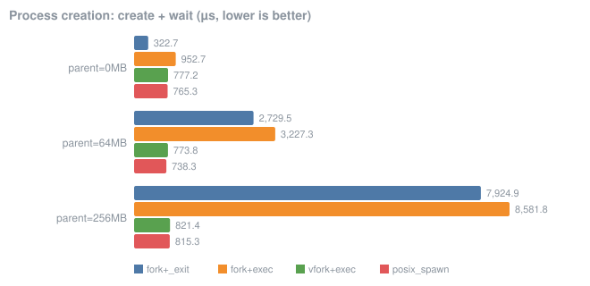
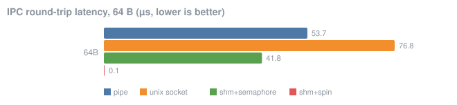
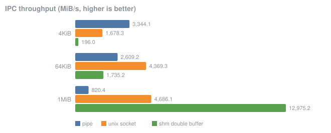
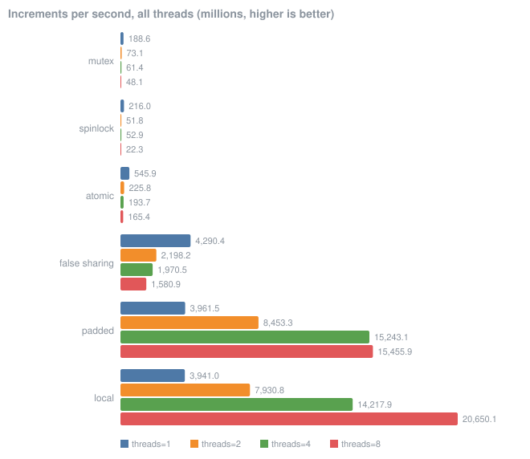
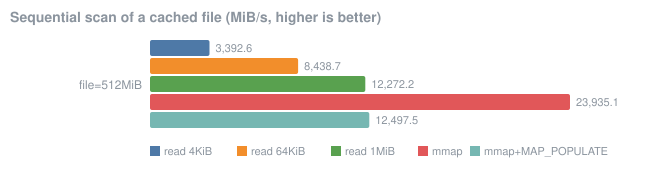

# Experiments and results

Every number here was produced by the programs in [`benchmarks/`](../benchmarks). The raw data
is in [`results/*.csv`](../results) and the machine description is in
[`results/environment.txt`](../results/environment.txt). Rerun everything with
`make bench`.

## Methodology

* **Environment:** AMD Ryzen 7 255 (8 cores / 16 threads), 15.3 GiB RAM, Linux 6.18 (WSL2) on
  Ubuntu 26.04, GCC 15.2 with `-O2`.
* **Warm-up:** one untimed run of every variant first.
* **Repetitions:** 5–7 timed repetitions per variant. The **median** is reported because it
  resists the outliers caused by scheduling, interrupts and CPU frequency changes.
* **Repeatability:** `bench_sync` was run twice in a row. Lock-based variants agreed within
  0–8 %. The fastest uncontended variants varied by up to 18 %, because they finish in a few
  milliseconds and are sensitive to which cores the threads land on.
* **Threats to validity:**
  * WSL2 is a Hyper-V virtual machine. Every wake-up of a sleeping process on another CPU goes
    through the hypervisor, so absolute latencies (fork, pipe ping-pong) are several times
    higher than on bare-metal Linux. The *comparisons* between variants are the point.
  * No CPU pinning, no disabled frequency scaling, a laptop with other programs open. The
    numbers describe this machine on this day, not Linux in general.
  * File I/O is measured with a warm page cache; this compares the two interfaces (copy vs.
    map), not disk speed.

---

## 1. Process creation: `fork` gets slower as the parent grows

`bench_spawn` creates a child running `/bin/true` and waits for it. The parent first touches
0, 64 or 256 MB of memory.

| µs per create+wait | parent 0 MB | parent 64 MB | parent 256 MB |
|---|---:|---:|---:|
| fork + _exit | 323 | 2,729 | 7,925 |
| fork + exec | 953 | 3,227 | 8,582 |
| vfork + exec | 777 | 774 | 821 |
| posix_spawn | 765 | 738 | 815 |

**Interpretation.** `fork()` must duplicate the parent's page tables. With copy-on-write the
pages themselves are not copied, but every page-table entry is, and each one is marked
read-only. 256 MB is 65,536 pages, so fork becomes **25× slower** than with an empty parent.
`vfork` and `posix_spawn` (glibc uses `clone(CLONE_VM | CLONE_VFORK)`) share the parent's
memory until `exec`, so their cost stays flat.

**Consequence.** A large program (a JVM, a browser, a database) should not start helpers with
`fork()+exec()`. That is why `posix_spawn` exists. lsh is small, so it can use the simpler and
more flexible `fork` path.

## 2. IPC latency: waking another process is the expensive part

`bench_ipc` bounces a 64-byte message between two processes and measures the round trip.

| mechanism | round trip |
|---|---:|
| pipe (two, one per direction) | 53.7 µs |
| Unix socket (`socketpair`) | 76.8 µs |
| shared memory + POSIX semaphores | 41.8 µs |
| shared memory + busy-waiting | **0.08 µs** |

**Interpretation.** The first three all put the receiver to sleep in the kernel and wake it up
again, so they cost about the same. The copy of 64 bytes is negligible. Busy-waiting on shared
memory never sleeps and is **~550× faster**, at the price of burning a whole CPU core while it
waits. The large absolute values of the sleeping variants come from the virtual machine
(see *threats to validity*). On bare metal the same experiment typically measures a few µs.

## 3. IPC throughput: the chunk size decides

The writer streams 512 MiB to the reader in chunks of 4 KiB, 64 KiB or 1 MiB.

| MiB/s | 4 KiB | 64 KiB | 1 MiB |
|---|---:|---:|---:|
| pipe | 3,344 | 2,609 | 820 |
| Unix socket | 1,678 | 4,369 | 4,686 |
| shared memory (double buffer) | 196 | 1,735 | **12,975** |

**Interpretation.**

* **Shared memory** needs one semaphore hand-off (a sleep and a wake-up, ~40 µs from section 2)
  per chunk. With 4 KiB chunks that overhead dominates: 4 KiB / ~20 µs ≈ 200 MiB/s, which is
  what was measured. With 1 MiB chunks the hand-off is amortised and the result is plain
  `memcpy` speed: 2.8× faster than a Unix socket and 16× faster than a pipe at that size.
* **Unix sockets** get faster with bigger writes, because there are fewer syscalls per byte.
* **Pipes** get *slower* with bigger writes. A pipe holds 64 KiB, so a 1 MiB `write()` cannot
  complete at once: the writer fills the pipe, sleeps, is woken when the reader drains it, and
  repeats about 16 times per call. Small writes keep reader and writer running in parallel
  instead. This result was not expected before measuring. `pipe_lab` shows that the capacity
  can be raised to 1 MiB with `F_SETPIPE_SZ`, and uutils `cat` does exactly that (see
  [syscall-tracing.md](syscall-tracing.md)).

## 4. Synchronization: contention, not locking, is what costs

Each thread increments a counter; the chart shows the total increments per second of all
threads together.

| M increments/s | 1 thread | 2 | 4 | 8 |
|---|---:|---:|---:|---:|
| mutex (shared counter) | 189 | 73 | 61 | 48 |
| spinlock (shared counter) | 216 | 52 | 53 | 22 |
| atomic `fetch_add` (shared) | 546 | 226 | 194 | 165 |
| **false sharing** (own counter, same cache line) | 4,290 | 2,198 | 1,971 | 1,581 |
| **padded** (own counter, own cache line) | 3,962 | 8,453 | 15,243 | 15,456 |
| local (own counter on the stack) | 3,941 | 7,931 | 14,218 | 20,650 |

**Interpretation.**

* With **one thread** a mutex costs about 5 ns per lock/unlock pair; nobody is waiting.
  With two threads the throughput drops by 2.6×: the cache line holding the lock and the counter
  now moves between cores on every increment. **Adding threads to a contended lock makes the
  program slower, not faster.**
* The **spinlock** collapses hardest at 8 threads: waiters burn CPU time while the lock holder
  may not even be running.
* **Atomics** avoid the lock but not the contention. The single cache line is still shared.
* **False sharing vs padded** is the cleanest result. Both variants give each thread its *own*
  variable and the code is identical. Only the memory layout differs: 8 bytes apart (one 64-byte
  cache line) vs 64 bytes apart. At 8 threads, padded is **9.8× faster**. False sharing
  also gets *slower* as threads are added, exactly like real contention. The hardware keeps
  caches coherent per line, not per variable.
* **Padded and local scale** almost linearly up to 4 threads. Beyond that, the 8 threads start
  sharing physical cores (SMT).

## 5. File access: `read()` vs `mmap()`

A 512 MiB file (already in the page cache) is summed as 64-bit words.

| method | MiB/s |
|---|---:|
| read, 4 KiB buffer | 3,393 |
| read, 64 KiB buffer | 8,439 |
| read, 1 MiB buffer | 12,272 |
| **mmap** | **23,935** |
| mmap + MAP_POPULATE | 12,498 |

**Interpretation.**

* `read()` copies every byte from the page cache into the user buffer, and costs one syscall per
  chunk. With 4 KiB chunks that is 131,072 syscalls for this file. Bigger buffers amortise the
  syscalls; the copy remains.
* `mmap()` maps the page-cache pages into the process: no copy at all, and the kernel's
  fault-around maps several pages per fault. It is **2× faster than the best `read()`** here.
* `MAP_POPULATE` pre-faults the whole 512 MiB before the scan starts. It was unexpectedly
  *slower* than plain `mmap`. A likely explanation is that populating 131,072 page-table entries
  up front is sequential kernel work that cannot overlap with the scan, while lazy faulting
  interleaves the two. This is a hypothesis; confirming it would need `perf`, which WSL2 does
  not support well.

## Summary

| question | answer measured here |
|---|---|
| Does fork get slower for big processes? | Yes, linearly in touched memory: 0.3 ms → 7.9 ms at 256 MB; `posix_spawn` stays at 0.8 ms |
| What dominates small-message IPC? | Sleeping and waking processes (~40–80 µs in a VM), not copying |
| Is shared memory always the fastest IPC? | Only with large transfers (13 GB/s at 1 MiB chunks); with 4 KiB chunks it is the slowest |
| Do more threads help a shared counter? | No: 8 threads are 4× slower than 1 with a mutex |
| How expensive is false sharing? | 9.8× at 8 threads, with identical code |
| read() or mmap() for scanning a file? | mmap, 2× faster than read() with a 1 MiB buffer |
